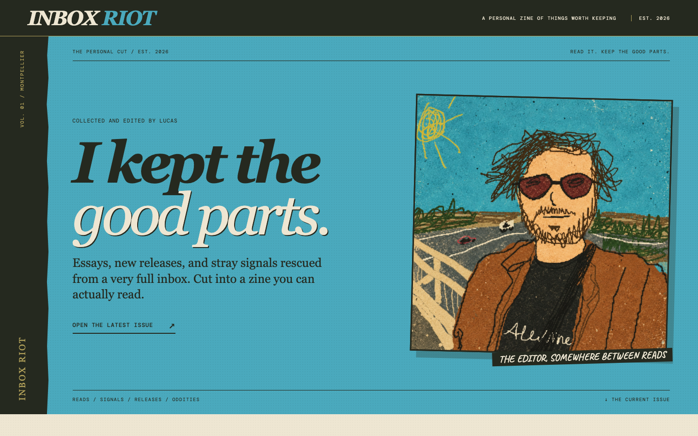

# Inbox Riot

## Why this exists

Newsletters still arrive by email, but the inbox is an old-fashioned place to keep up. Morning briefs and digests give us a map before we read; a pile of messages asks us to open every email, click every article, and work out its importance from scratch. The good pieces get buried alongside announcements, offers, and noise.

Inbox Riot creates an edited zine from the newsletters and updates in your email. It follows the links to full articles, gives the most consequential topics the front page, and puts specific takeaways beside the original sources. The Reading Room makes a long newsletter backlog navigable without losing the writer's language or the path back to the full work. It is a way to catch up with *everything worth reading* without treating every subject line as equally urgent.

**[Read my zine →](https://lsbonafe.github.io/inbox-riot-pages/)**

<a href="https://lsbonafe.github.io/inbox-riot-pages/"></a>

## How it works

```text
Upstream mail agent (LLM)
  └─ reads incoming email and applies source labels
                              │ zine reads those labels; never re-sorts
                              ▼
Scheduled zine editor (LLM)
  ├─ reads all unprocessed emails under the source labels
  ├─ opens full articles linked from Reads; reads the full email
  │  when no public article exists
  ├─ compares sources with past issues to avoid repeats
  ├─ ranks stories, writes takeaways, chooses images or art
  └─ follows the public editorial rules and design system
                              │ writes reviewed issue and assets
                              ▼
Private instance repository (main)
  ├─ stores site config, public-safe issue JSON, approved assets
  ├─ stores the task prompt and publishing workflow
  └─ triggers CI on an authorized push to main
     (repo settings hold the deploy key secret, not a file)
                              │ private workflow starts
                              ▼
Private GitHub Actions
  ├─ fetches public repository (main) at pinned ENGINE_REF
  │  Public main provides Astro, design rules, schemas, and tests
  ├─ applies private config, issue JSON, and approved assets
  ├─ runs tests, checks, validation, and the static build
  └─ pushes dist/ with a scoped deploy key
                              │ rendered files only
                              ▼
Public repository (gh-pages)
  └─ supplies built HTML, CSS, and assets to GitHub Pages
                              │ editor verifies the live issue
                              ▼
Email: editor applies the processed label to reviewed,
       decided messages
```

The private task prompt controls unattended writes; its starter setting is `AUTOPUBLISH_AUTHORIZED=false`. A run with no publishable issue skips deployment and closes only reviewed, final decisions after writes are enabled.

**Public repository, `main`:** reusable Astro engine, issue schema, design system, renderers, tests, and a [starter for your own instance](templates/private-instance/README.md). Its example config and issue are synthetic.

**Private repository, `main`:** your site config, edited issues, approved assets, scheduled prompt, and publishing workflow. Raw email stays with your email provider; credentials stay in connected tools and GitHub Secrets.

**Public repository, `gh-pages`:** rendered HTML, CSS, and assets. The text and images intentionally published in an issue are public here.

## Create your own

Fork this project and make it yours. The public engine is MIT licensed; your mail, identity, and editorial decisions stay under your control.

1. **Fork the public engine.** Keep its `main` branch for the reusable code. This fork can also host your rendered zine on its `gh-pages` branch.
2. **Create a private instance repository.** Copy the [private starter](templates/private-instance/README.md), including its hidden `.github/workflows/publish.yml`. Fill `config/site.json` with your title, portrait, location, URL, and landing-page copy. There are no personal production defaults in the engine.
3. **Connect your LLM.** Connect it to your email account so it can read messages and apply labels, and to GitHub so it can read the public engine and write to your private instance. Test those permissions before relying on a schedule.
4. **Set up email labeling.** Choose a source label and sublabels that fit your inbox. Create a separate LLM routine that reads incoming email and applies those labels, or use a labeling routine you already have. Reserve a distinct processed label for the zine editor; it reads the source labels without changing your sorting.
5. **Connect private publishing to your public fork.** Give the private workflow a deploy key scoped to the public fork. Set its `PAGES_DEPLOY_KEY` secret, `PAGES_REPOSITORY` variable (`owner/repo`), and `ENGINE_REF` variable (a reviewed 40-character commit SHA from your public engine). Follow the [starter setup](templates/private-instance/README.md) for the exact paths. In your public fork's Pages settings, publish from `gh-pages` at `/(root)`.
6. **Schedule the zine editor.** Adapt the [sample task prompt](templates/private-instance/SCHEDULE_PROMPT.md) with your labels, repositories, interests, time zone, and schedule, then paste it into your LLM's scheduled task. The editor reads labeled emails and linked sources, checks past issues, and prepares an issue using the public editorial rules. Keep `AUTOPUBLISH_AUTHORIZED=false` until you explicitly enable unattended publication.
7. **Run and verify an edition.** Once enabled, the scheduled editor writes public-safe [issue JSON](editorial/ISSUE_FORMAT.md) and approved assets to private `main`. Its push runs the private workflow, which tests and builds the site and publishes only `dist/` to public `gh-pages`. The editor verifies the live issue before applying the processed email label.

The [editorial contract](editorial/MASTER_PROMPT.md), [design system](editorial/DESIGN_SYSTEM.md), and [art direction](editorial/ART_DIRECTION.md) guide every edition. The MIT license covers the engine and documentation; [content rights](CONTENT_RIGHTS.md) for published writing and third-party material are separate.
